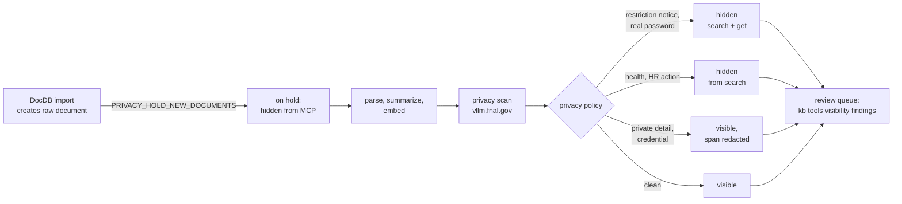

# Privacy: what the MCP tools may show

Everything in the knowledge base is readable by Mu2e collaboration members in
DocDB already. The risk this system guards against is narrower: an AI client
connected over MCP — usually backed by an external, commercial LLM — pulling a
personnel matter, a password or a partner's proprietary drawing into a
conversation, unprompted or out of context. Fermilab's guidance allows public
AI tools to see open (Level 1) information only; on-prem models
(`vllm.fnal.gov`) may see Levels 1–3.

Three mechanisms keep such content away from the agent-facing tools, and none
of them changes the stored data:

| Mechanism | What it does | Decided by |
|---|---|---|
| **Visibility** | hides a whole document from `kb_search`, or from `kb_search` and `kb_get` | the privacy policy (provisional), or a person with `hide`/`show` |
| **Redaction** | replaces a secret or private detail with `[redacted: <label>]` in the tools' output | built-in patterns, the policy, or a person with `redact` |
| **Privacy scan** | an on-prem LLM reads every document and lists what it found, with quotes | runs in the import job; results go to review |

Only the MCP tools (`kb_search`, `kb_get`, `kb_get_image`, `kb_research`, the
graph tools and the `kb://document` resource) apply visibility and redaction.
The CLI and the web UI always see everything — they are for the people who
review it.

## How a new document flows



1. **Hold.** With `PRIVACY_HOLD_NEW_DOCUMENTS=true`, every new raw document is
   hidden (search and get) in the same transaction that creates it, so it is
   never visible unscanned — not even for the minutes the import takes. This
   applies to every import path and to web uploads.
2. **Scan.** After the import (and its summaries), `kb-docdb-update.sh` runs
   `kb tools visibility scan --only-unscanned`. The LLM reads the document's
   title, AI summary and full text in overlapping windows of ~6k tokens.
3. **Policy.** `kb tools visibility apply-policy --apply` turns the findings
   into provisional decisions and redactions (rules below) and lifts the hold
   on everything else.
4. **Review.** A person goes through `kb tools visibility findings` and
   confirms, corrects or undoes what the policy did.

If the LLM is unreachable, documents simply stay held and the next run (12 h
later) retries them. The import log then shows `PRIVACY FAILED`.

## What the scan looks for

The prompt (`src/kb_mcp/privacy/sensitivity.py`, versioned as `PROMPT_VERSION`)
asks for passages in these categories, each with a severity, the quoted
evidence and the exact span to remove:

| Category | Examples | Not reported |
|---|---|---|
| `restricted` | "General Atomics Proprietary Information", "Internal Use Only", "not for public distribution", export controlled, OUO, CUI, NDA | "proprietary alloy", ITAR logos, training about CUI, e-mail disclaimers |
| `credentials` | passwords, Zoom passcodes and `pwd=` links, lock combinations, tokens, purchase-card IDs | "log in with your services password" |
| `personal_data` | private mobile or gmail, date of birth, ID numbers, health or injury, family | collaboration directories, work e-mail and office phones, vendor contacts |
| `personnel` | disciplinary action, performance problems, salary of a named person, visa status | roles, retirements, people joining or leaving |
| `individual_assessment` | reference letters, candidate rankings, review comments about a person | |
| `security` | firewall rules, vulnerabilities, internal IPs of control/DAQ systems | hostnames, software versions |

Alongside the LLM, fixed-wording **markers** (proprietary/confidential notices,
OUO, CUI banners, export control, "internal use only") are matched by pattern,
because the model alone missed some of them.

The scan only talks to on-prem endpoints: it refuses any host outside
`vllm.fnal.gov` and `inference-api.alcf.anl.gov` unless `--allow-endpoint` is
given. The model is `PRIVACY_FILTER_MODEL` (`gpt-oss:120b` in
`deploy/mu2e.env`), which `OPENAI_BASE_URL_MODELS` in the private config routes
to `vllm.fnal.gov`. A full scan of the corpus (~4,000 text documents,
~32M tokens) takes about 45 minutes at 6 parallel requests; the import job's
incremental scan takes seconds per new document.

## The policy

`apply-policy` looks at each document's latest scan of every prompt version
from v3 on — the model varies between runs, so a finding in any of them
counts — and ignores findings a redaction already covers:

| Finding | Action |
|---|---|
| restriction notice (medium or high) | **hide from search and get** |
| credential, high (a real password) | **hide from search and get**, and redact it |
| credential, medium | redact the exact span (no exact span: flag) |
| personal data / personnel / assessment, high | redact the span if exact, **hide from search** |
| personal data, medium | redact the exact span |
| anything else, medium or high | flag for review |
| low | nothing |

Decisions the policy makes carry the origin `privacy-policy` and are
**provisional**: a later run may change or lift them (a re-scan that comes back
clean lifts a hide). A decision a person makes with `hide` or `show` always
wins and is never changed by the policy; redactions still apply to such a
document.

## Built-in redaction patterns

These apply to every document, including future imports, without review
(`GLOBAL_PATTERNS` in `src/kb_mcp/privacy/redaction.py`):

| Pattern | Replaces | Example |
|---|---|---|
| `meeting-link-pwd` | the token of a `?pwd=` meeting link | `…?pwd=[redacted: meeting passcode]` |
| `passcode-or-password` | the value after passcode / password / pwd / pin / `pw:` | `Passcode: [redacted: credential]` |
| `purchase-card` | `Card#NAME 1234` | `[redacted: payment card]` |
| `private-key`, `api-token` | PEM private keys, AWS/GitHub/Slack/OpenAI-style tokens, JWTs | |

Redaction happens before search excerpts are cut, so an excerpt never shows
half a secret. `kb_get_image` withholds an image whose description contains
redacted content, since pixels cannot be redacted.

## Reviewing

```bash
# What needs a look (findings already covered by a redaction are not shown)
kb tools visibility findings --min-severity medium

# What the policy would do / did
kb tools visibility apply-policy --verbose          # dry run
kb tools visibility list --hidden                   # current hides

# Decide
kb tools visibility hide <doc> --reason "..." [--search-only]
kb tools visibility show <doc> --reason "reviewed, fine"     # also undoes a provisional hide
kb tools visibility redact <doc> --span "..." --label "phone number" --reason "..."
kb tools visibility redact <doc> --from-findings --dry-run   # approve the scan's spans
kb tools visibility unredact <rule-id>

# Check
kb tools visibility preview <doc>       # exactly what an agent sees redacted or withheld
kb tools visibility history <doc>       # every decision, who and why
kb tools visibility redactions [<doc>]
```

A rule of thumb for decisions: **the fact of an event is fine, personal
correspondence about it is not.** A resignation announced in the Institutional
Board slides stays visible; the resignation letter itself stays out of search.
Likewise a member directory (office numbers of hundreds of people) is better
hidden as a whole than redacted line by line.

`<doc>` is a raw document UUID, a document UUID, `source_id/doc_id` or a bare
`doc_id`. Running servers pick up redaction rules within a minute; visibility
decisions apply immediately.

## Operations

**Settings** (`deploy/mu2e.env`, environment for the import job):

| Setting | Meaning |
|---|---|
| `PRIVACY_HOLD_NEW_DOCUMENTS=true` | hold new documents and run the privacy step in `kb-docdb-update.sh` |
| `PRIVACY_FILTER_MODEL` | model for the scan; must route to an on-prem endpoint |
| `PRIVACY_SCAN_CONCURRENCY` (4), `PRIVACY_SCAN_MAX_MINUTES` (60) | limits for the import job's scan |

**Changing the prompt.** Bump `PROMPT_VERSION`, then re-scan everything
outside the import window (the import job only scans documents no version has
scanned):

```bash
kb tools visibility scan --max-minutes 60 --concurrency 6   # resumable; repeat until done
kb tools visibility apply-policy --verbose                   # review the plan
kb tools visibility apply-policy --apply
```

**Rolling out** (once, with the release that enables the hold): the existing
corpus has been scanned already, so apply the policy to it — dry run, review,
then `--apply`. Documents imported before the hold existed are picked up by the
import job's next `--only-unscanned` scan.

**Tables.** `document_sensitivity_scans` (one row per scan of a document),
`document_redactions` (span rules), and the visibility tables
`document_visibility_decisions` / `document_visibility_current` /
`document_visibility_runs` (every scan and policy run is a run row with its
counts).

## Limits

- **The LLM misses things and varies between runs.** Formats with a pattern
  are caught reliably; everything else depends on the model. Two known misses
  in testing: a health remark in a spreadsheet log, and purchase-card lines in
  some cost reports (now covered by a pattern).
- **Images are judged by their description.** A screenshot showing a
  password is caught only if the description transcribed it.
- **Documents over 500,000 characters are not scanned** (the giant financial
  spreadsheets). Hide them with `kb tools visibility sweep --rule
  oversized-spreadsheet --apply [--hide-get]`.
- **A hide or a span rule applies per raw file**, so one bad slide hides the
  whole deck it came from.
- **The graph tools do not apply visibility or redaction**, so
  `PRIVACY_HOLD_NEW_DOCUMENTS=true` turns them off (as `HIDE_GRAPH=true`
  does) until they do.
- **Files the scan cannot read** — no text, empty text, or more than 500,000
  characters — are hidden from search (not from `kb_get`) and flagged, rather
  than held forever.
- **Policy questions are not answered here.** Whether, say, contractor
  drawings count as restricted is for the lab to decide; the scan only finds
  what is marked or recognisably sensitive.
